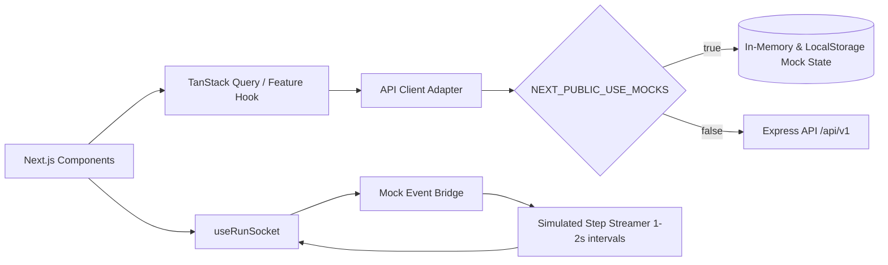
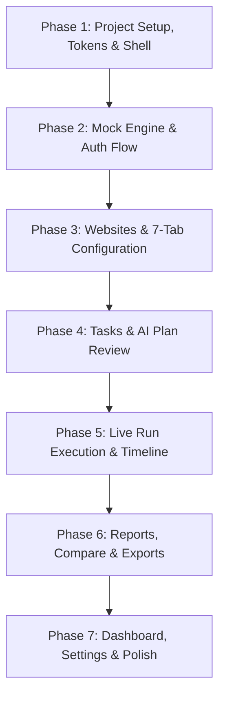

# SentinelQA — Frontend Implementation & Execution Plan

> **Scope:** Complete, production-grade Next.js (App Router) frontend implementation for the **SentinelQA (AI Website Testing Agent)** platform, built according to [`Docs/03-frontend-implementation.md`](file:///home/sit-shiv/web-testing-agent/Docs/03-frontend-implementation.md) and [`Docs/ui_guidlience.md`](file:///home/sit-shiv/web-testing-agent/Docs/ui_guidlience.md).  
> **Backend Independence:** Incorporates a fully typed mock data and real-time simulation layer so the complete user experience (including AI generation and live test runs) functions seamlessly before and after backend integration.

---

## 1. Executive Summary & Design Principles

The frontend for SentinelQA delivers a modern, high-density, Linear-inspired QA orchestration interface. It treats human language as test plan specifications, gives QA teams precise oversight before execution, and provides real-time visibility into test runs.

### Guiding Principles (from `ui_guidlience.md`)
1. **Matte Surfaces & Hairline `1px` Borders (Zero Blurred Drop Shadows)**
   - Depth is achieved through surface contrast (`--bg` vs `--surface` vs `--surface-elevated`) and hairline `1px` borders (`--border` / `--border-hover`).
2. **Strict Monochrome Chrome**
   - Navigation, sidebar, topbar, tables, inputs, and structure remain neutral monochrome.
   - Color is restricted to:
     - **Semantic statuses**: `Passed` (green), `Failed` (red), `Error`/`In review` (amber), `Running` (sky blue).
     - **Environment tags**: `DEV`, `STAGING`, `QA`, `PRODUCTION`.
     - **AI focus & active states**: `--primary` (`#4F46E5` / `#818CF8`) and `--ai-ring`.
3. **Typography & Numeric Discipline**
   - `Inter` for UI text, labels, and headings.
   - `JetBrains Mono` (`tabular-nums`) for all metrics, test case IDs, URLs, timestamps, durations, and AI model tags.
4. **First-Class Dual Theme (Light + Dark + System)**
   - No hardcoded hex values or raw `white/[...]` / `black/[...]` Tailwind classes in component code.
   - Zero-flash SSR hydration via an inline pre-paint script in `app/layout.tsx`.
5. **Tactile Micro-Animations**
   - 120ms–250ms smooth transitions with full `@media (prefers-reduced-motion: reduce)` compliance.
6. **Mandatory Four Data States**
   - Every async container handles **Skeleton**, **Empty** (with CTA), **Error** (with Retry), and **Populated** via `<StateView />`.
7. **URL-Synchronized State**
   - All filters, search terms, pagination, and active tabs sync with URL `searchParams`.

---

## 2. Architecture & File Structure

```
apps/web/ (or root project structure)
├── public/
│   ├── fonts/
│   └── favicon.ico
├── src/
│   ├── app/
│   │   ├── layout.tsx                           # Root layout (Theme script, Inter + JetBrains Mono)
│   │   ├── providers.tsx                        # TanStack Query, ThemeProvider, ToastProvider
│   │   ├── (auth)/
│   │   │   └── login/page.tsx                   # Minimal centered auth card (lockout alert)
│   │   ├── (app)/
│   │   │   ├── layout.tsx                       # AppShell: Sidebar + Topbar + CommandMenu
│   │   │   ├── dashboard/page.tsx               # KPIs, 30d trend, recent runs, needs-approval queue
│   │   │   ├── websites/
│   │   │   │   ├── page.tsx                     # Websites list/grid + search + filters
│   │   │   │   ├── new/page.tsx                 # Register website modal/page (URL validation)
│   │   │   │   └── [id]/
│   │   │   │       ├── page.tsx                 # Website detail overview
│   │   │   │       └── config/page.tsx          # 7-tab config (Roles, Modules, Auth, Rules, etc.)
│   │   │   ├── tasks/
│   │   │   │   ├── page.tsx                     # Tasks list (status badges, engine tags)
│   │   │   │   ├── new/page.tsx                 # 2-col form: Task inputs + Live Context Preview
│   │   │   │   └── [id]/page.tsx                # Task overview, plan versions, execution history
│   │   │   ├── plans/
│   │   │   │   └── [id]/page.tsx                # Core review: CaseCards, StepEditor, Diff, Lock banner
│   │   │   ├── runs/
│   │   │   │   └── [id]/page.tsx                # Live run: Status bar, Timeline, Step table, Diagnostics
│   │   │   ├── reports/
│   │   │   │   ├── page.tsx                     # Reports list + date/task grouping + compare launcher
│   │   │   │   ├── [id]/page.tsx                # Report detail + export (PDF/CSV/JSON) + share link
│   │   │   │   └── compare/page.tsx             # Side-by-side run comparison
│   │   │   ├── notifications/page.tsx           # Grouped notification center
│   │   │   └── settings/
│   │   │       ├── page.tsx                     # Redirects to general
│   │   │       ├── general/page.tsx             # Timeouts, retention, approver toggle, kill switch
│   │   │       ├── providers/page.tsx           # Ollama + Gemini config, health check, model picker
│   │   │       ├── users/page.tsx               # User management table & invite modal
│   │   │       └── audit/page.tsx               # Append-only audit log with diff drawer
│   │   ├── not-found.tsx                        # 404 screen
│   │   ├── error.tsx                            # Error boundary with retry
│   │   └── loading.tsx                          # App-level skeleton loader
│   ├── components/
│   │   ├── ui/                                  # Pure presentational primitives (shadcn-compatible)
│   │   │   ├── button.tsx
│   │   │   ├── input.tsx
│   │   │   ├── textarea.tsx
│   │   │   ├── select.tsx
│   │   │   ├── switch.tsx
│   │   │   ├── checkbox.tsx
│   │   │   ├── dialog.tsx
│   │   │   ├── sheet.tsx
│   │   │   ├── dropdown-menu.tsx
│   │   │   ├── tabs.tsx
│   │   │   ├── tooltip.tsx
│   │   │   ├── badge.tsx
│   │   │   ├── card.tsx
│   │   │   ├── table.tsx
│   │   │   ├── skeleton.tsx
│   │   │   └── toast.tsx
│   │   ├── layout/
│   │   │   ├── AppShell.tsx                     # Root admin container
│   │   │   ├── Sidebar.tsx                      # 240px / 64px collapsible + mobile sheet
│   │   │   ├── Topbar.tsx                       # Breadcrumbs, Command trigger, engine status, user
│   │   │   ├── PageHeader.tsx                   # Title, subtitle, primary action button
│   │   │   ├── Breadcrumbs.tsx
│   │   │   └── CommandMenu.tsx                  # ⌘K search & quick actions
│   │   ├── data/
│   │   │   ├── DataTable.tsx                    # TanStack Table wrapper (sort, filter, pagination)
│   │   │   ├── StateView.tsx                    # 4-state handler (Skeleton, Empty, Error, Populated)
│   │   │   ├── FilterBar.tsx                    # Search input + select chips + reset button
│   │   │   └── Pagination.tsx                   # Page size select + page numbers
│   │   ├── charts/
│   │   │   ├── TrendChart.tsx                   # 30-day Pass/Fail area/line chart
│   │   │   ├── PassRateDonut.tsx                # Pass rate donut with center percentage
│   │   │   └── DurationBars.tsx                 # Step execution duration bars
│   │   └── domain/
│   │       ├── StatusBadge.tsx                  # Semantic status (Icon + label + animated running dot)
│   │       ├── EnvBadge.tsx                     # DEV, STAGING, QA, PRODUCTION badge
│   │       ├── EngineSwitch.tsx                 # Ollama vs Gemini segmented selector with health dot
│   │       ├── EngineBadge.tsx                  # Ollama / Gemini model tag
│   │       ├── CaseCard.tsx                     # Expandable test case card
│   │       ├── StepEditor.tsx                   # Inline editable step table (target, check, expected)
│   │       ├── PlanDiff.tsx                     # Side-by-side diff between plan versions
│   │       ├── PlanLockBanner.tsx               # Approved lock state notice + "Create vN+1" button
│   │       ├── Timeline.tsx                     # Step execution timeline with timestamps & duration
│   │       ├── StepLogDrawer.tsx                # Request/response summary, payload, error details
│   │       └── StatCard.tsx                     # KPI card with trend delta indicator
│   ├── features/                                # Feature modules (API clients, hooks, schemas)
│   │   ├── auth/
│   │   ├── websites/
│   │   ├── config/
│   │   ├── tasks/
│   │   ├── plans/
│   │   ├── runs/
│   │   ├── reports/
│   │   └── providers/
│   ├── mocks/                                   # Full mock engine & simulation
│   │   ├── data/                                # Mock seed data (websites, configs, tasks, runs, plans)
│   │   │   ├── websites.mock.ts
│   │   │   ├── tasks.mock.ts
│   │   │   ├── plans.mock.ts
│   │   │   ├── runs.mock.ts
│   │   │   └── reports.mock.ts
│   │   ├── mockClient.ts                        # Seamless HTTP client interceptor
│   │   └── mockSocket.ts                        # Real-time WebSocket simulator for live test runs
│   ├── lib/
│   │   ├── apiClient.ts                         # Axios / Fetch client with mock fallback
│   │   ├── socket.ts                            # Socket.IO hook + mock socket bridge
│   │   ├── permissions.ts                       # can(role, permission) RBAC helpers
│   │   ├── format.ts                            # Duration, dates, byte size formatters
│   │   └── utils.ts                             # cn (clsx + tailwind-merge)
│   ├── stores/
│   │   ├── ui.store.ts                          # Theme (light/dark/system), sidebar collapsed state
│   │   ├── auth.store.ts                        # Active user & session state
│   │   └── filters.store.ts                     # Persisted table and view preferences
│   └── styles/
│       ├── globals.css                          # Tailwind layers, font settings, scrollbars
│       └── tokens.css                           # CSS variables (:root and .dark)
```

---

## 3. Design Tokens & Styling Specification

### CSS Variables (`tokens.css`)

```css
:root {
  /* Surfaces & Canvas */
  --bg: #FAFAFB;
  --surface: #FFFFFF;
  --surface-elevated: #F4F5F8;
  --border: #E7E8EC;
  --border-hover: #CFD2DC;
  
  /* Typography */
  --text: #0F1222;
  --text-muted: #6B7080;
  
  /* Overlays & Chrome */
  --topbar-bg: rgba(250, 250, 251, 0.85);
  --overlay-bg: rgba(15, 18, 34, 0.35);
  --hover-row: rgba(15, 18, 34, 0.025);
  --hover-subtle: rgba(15, 18, 34, 0.04);
  --track-bg: #ECEEF2;
  
  /* Primary & AI Accent */
  --primary: #4F46E5;
  --primary-hover: #4338CA;
  --primary-tint: #EEF0FF;
  --primary-text: #FFFFFF;
  --ai-ring: rgba(79, 70, 229, 0.25);
  
  /* Semantics */
  --success: #16A34A;
  --success-tint: #E8F7EE;
  --danger: #DC2626;
  --danger-tint: #FDECEC;
  --warning: #D97706;
  --warning-tint: #FDF3E1;
  --info: #0284C7;
  --info-tint: #E6F4FB;
}

.dark {
  --bg: #0B0D14;
  --surface: #12151F;
  --surface-elevated: #171B26;
  --border: #232838;
  --border-hover: #323950;
  
  --text: #E8EAF2;
  --text-muted: #8B90A3;
  
  --topbar-bg: rgba(11, 13, 20, 0.85);
  --overlay-bg: rgba(0, 0, 0, 0.62);
  --hover-row: rgba(255, 255, 255, 0.025);
  --hover-subtle: rgba(255, 255, 255, 0.04);
  --track-bg: rgba(255, 255, 255, 0.06);
  
  --primary: #818CF8;
  --primary-hover: #6366F1;
  --primary-tint: rgba(129, 140, 248, 0.12);
  --primary-text: #0B0D14;
  --ai-ring: rgba(129, 140, 248, 0.30);
  
  --success: #22C55E;
  --success-tint: rgba(34, 197, 94, 0.12);
  --danger: #EF4444;
  --danger-tint: rgba(239, 68, 68, 0.12);
  --warning: #F59E0B;
  --warning-tint: rgba(245, 158, 11, 0.12);
  --info: #38BDF8;
  --info-tint: rgba(56, 189, 248, 0.12);
}
```

---

## 4. Key Page Specifications

| Page | Key Components & Layout | Critical Behaviors & Actions |
|---|---|---|
| **`/login`** | Centered 400px card, email/password fields, show/hide password, error alert banner. | Client-side validation, lockout warning simulation, remembers last login. |
| **`/dashboard`** | 4 KPI StatCards, 30-day trend chart (Pass/Fail area), recent runs table, "Needs approval" queue card. | Quick actions: "Add Website", "Create Task", "Re-run last task". Date & website filter controls. |
| **`/websites`** | Grid/List toggle, search filter, environment filter chips, "Add website" modal trigger. | Website status cards showing URL, environment badge, last run status, task count, kebab actions. |
| **`/websites/[id]`** | Header with environment badge + actions. Overview tab with health score & completeness checklist. | Links directly to Tasks, Runs, and the 7 Configuration tabs. |
| **`/websites/[id]/config`** | 7 Tabs: Roles, Modules, Auth Flow, Business Rules, Custom Instructions, Credentials, Versions. | Masked credential inputs (`••••••••`) with prominent *"Never sent to AI"* notice. Version diff & restore. |
| **`/tasks/new`** | Two-column layout: Left column = task goal form; Right column = **Live Context Preview**. | Segmented `EngineSwitch` (Ollama/Gemini) with live health dot. Context card shows what the AI will receive. |
| **`/plans/[id]`** | Version header, token count, case list (`CaseCard`), steps table (`StepEditor`), version diff, reviewer notes. | Drag/inline step reordering, validation-type selector. **Approve & Finalize** triggers plan lock (`vN+1` on subsequent edits). |
| **`/runs/[id]`** | Run header, animated progress bar, status chips, split view: **Timeline** (left) + **Step Table** (right). | Real-time WebSocket streaming with simulated live runner. Expandable step rows show timing, request/response summaries, and QA notes. |
| **`/reports`** | Grouped table (Task-wise / Date-wise), pass rate chips, duration, CSV export, "Compare Runs" (2 selected). | Select 2 checkboxes to activate side-by-side comparison. |
| **`/reports/compare`** | Two-column run summary + step-by-step diff table. | Highlights status transitions (e.g., Passed → Failed in red) and duration deltas. |
| **`/settings/*`** | Provider cards (Ollama URL + model picker, Gemini key + tier picker, connection test), Users table, Audit log. | Admin-only role guards, connection test button with latency indicator, append-only audit trail. |

---

## 5. Mock Data & Real-Time Simulation Engine

To guarantee a fully interactive frontend without requiring an active backend or LLM endpoints, the project includes a self-contained simulation layer:



### Simulation Capabilities:
1. **AI Plan Generation Simulation**:
   - Displays a multi-step generation card with live progress bar and step counter.
   - Generates realistic test plans for the golden task (*"Verify login and open the Tracking page"*) with 5 test cases and 7-15 timed steps.
2. **Live Test Execution Simulation**:
   - `MockSocket` emits `run.started`, followed by sequential `step.started` and `step.finished` events.
   - Calculates realistic millisecond durations (`42ms` to `380ms`), tracks monotonic start/finish timestamps, and dynamically updates the timeline.
3. **Interactive Plan Review & Locking**:
   - Allows inline editing of step actions, targets, and expected outcomes.
   - Locking a plan transitions its status to `Approved` and generates a new version (`v2`) upon subsequent edits.
4. **Export & Share Generation**:
   - Generates and downloads real CSV/JSON files client-side and creates expiring share links.

---

## 6. Phased Implementation Roadmap



### Phase 1: Project Foundation & Design System
- Initialize Next.js 14+ (App Router) with TypeScript and Tailwind CSS.
- Configure `tokens.css` with full light/dark palette, typography (`Inter` + `JetBrains Mono`), and `tabular-nums`.
- Create zero-flash theme switching with `<ThemeSync />` and `<ThemeSwitch />` (Sun/Moon/System).
- Build the core AppShell: `Sidebar` (collapsible 240px/64px), `Topbar` (breadcrumbs, ⌘K trigger, engine status dot), and `<CommandMenu />`.
- Build shared UI primitives: `Button`, `Input`, `Select`, `Switch`, `Badge`, `Card`, `Table`, `Dialog`, `Sheet`, `StateView`.

### Phase 2: Mock State & Authentication
- Implement `src/mocks/` with rich seed data matching the complete Prisma schema.
- Implement `apiClient.ts` with mock toggle (`NEXT_PUBLIC_USE_MOCKS`).
- Implement `/login` page with authentication state simulation, lockout alert, and role-based access presets (`Admin`, `QA Lead`, `QA Engineer`, `Viewer`).

### Phase 3: Websites & 7-Tab Configuration
- Build `/websites` (list/grid view, environment filters, search, "Add Website" modal).
- Build `/websites/[id]` overview with completeness score and recent runs.
- Build `/websites/[id]/config` with all 7 tabs:
  1. Roles (table + drawer)
  2. Modules (table + navigation path builder)
  3. Auth flow (login route, form selectors, success indicator)
  4. Business rules (priority chips, active toggles)
  5. Custom instructions (prompt textarea with token counter)
  6. Masked credentials (with *"Never sent to AI"* disclaimers)
  7. Version history (diff & restore)

### Phase 4: Task Creation & Dual-Engine Plan Review
- Build `/tasks` list and `/tasks/new` with side-by-side **Task Form** and **Live Context Preview**.
- Implement `EngineSwitch` with Ollama/Gemini health indicators.
- Build `/plans/[id]` review screen:
  - `CaseCard` with expandable steps.
  - Inline `StepEditor` for actions, validation types, and expected outputs.
  - Plan approval action that locks the plan into read-only mode.
  - "Regenerate with feedback" modal and version diff viewer (`PlanDiff`).

### Phase 5: Live Run Execution & Timeline
- Build `/runs/[id]` with real-time runner interface.
- Implement `useRunSocket` and `MockSocket` to stream simulated live execution:
  - Dynamic progress bar with live percentage and step counter.
  - Left column: Chronological vertical `Timeline` with duration chips.
  - Right column: Step execution table with status badges (`Passed`, `Failed`, `Running`).
  - Slide-out `StepLogDrawer` displaying request/response payloads, timing, and QA notes.

### Phase 6: Reports & Run Comparison
- Build `/reports` with date-wise and task-wise grouping.
- Build `/reports/[id]` detail view with pass-rate donut, failure breakdown, and share link modal.
- Client-side export functionality for CSV, JSON, and printable PDF.
- Build `/reports/compare?a=&b=` side-by-side comparison showing step status transitions and duration deltas.

### Phase 7: Dashboard, Settings, Accessibility & Polish
- Build `/dashboard` with KPI cards, 30-day trend chart (Recharts), and "Needs approval" queue.
- Build `/settings` (AI Provider health checks, user management, append-only audit log).
- Accessibility audit: WCAG AA contrast verification, keyboard navigation (`⌘K`, `Esc`), ARIA roles, and `prefers-reduced-motion` validation.

---

## 7. Verification & Acceptance Criteria

1. **Theme Parity**: Zero flash on page reload in dark mode; all tokens switch cleanly across Light, Dark, and System modes.
2. **Design Fidelity**: Strict adherence to `1px` borders, zero blurred drop shadows, monochrome chrome, and `JetBrains Mono` for all numbers, routes, and IDs.
3. **Interactive Flow**: A user can navigate from `/dashboard` → `/websites` → `/tasks/new` → generate a plan → edit and approve it → trigger a live run → view real-time timeline streaming → inspect the final report.
4. **Security & Trust Signals**: Masked credentials and disclaimers are prominent wherever credentials or AI inputs appear.
5. **Accessibility**: Lighthouse Accessibility score ≥ 95 with full keyboard navigability.

